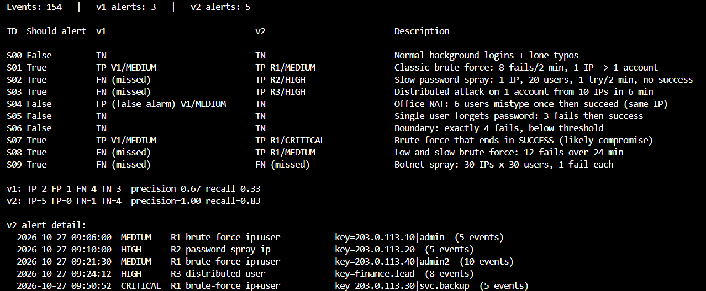

# Task 9 — Test a Defensive Detection Rule

**Goal:** take a detection rule, test it against synthetic logs, find false positives and missed cases, and improve it.
**Everything here is synthetic.** No real users, IPs or credentials. (IPs are from the documentation ranges 192.0.2.0/24, 198.51.100.0/24, 203.0.113.0/24, 100.64.0.0/10.)

## 1. The rule under test (v1)
> Alert when a single source IP has **>= 5 failed logins within 5 minutes**.

The task PDF did not include a rule file, so I used this very common baseline brute-force rule as the "supplied" rule.

## 2. Method
1. **Hypothesis:** a per-IP, 5-minute counter catches fast brute force but will (a) miss slow/distributed attacks and (b) false-alarm on shared IPs such as an office NAT.
2. Built 10 labelled scenarios (`scenarios.py`) in 154 synthetic events (`generate_logs.py` -> `logs.csv`). Labels live in a separate file (`ground_truth_labels.csv`) so the rule never sees them, like real logs.
3. Wrote the expected answer ("should this alert?") for every scenario **before** running the rule.
4. Ran v1 (`rules.py`), compared against expectations (`run_tests.py`), then iterated to v2 and re-ran.

## 3. Test cases and results (actual output, `results.txt`)
```
Events: 154   |   v1 alerts: 3   |   v2 alerts: 5

ID  Should alert  v1                              v2                          Description
--------------------------------------------------------------------------------------------------------------
S00 False         TN                              TN                          Normal background logins + lone typos
S01 True          TP V1/MEDIUM                    TP R1/MEDIUM                Classic brute force: 8 fails/2 min, 1 IP -> 1 account
S02 True          FN (missed)                     TP R2/HIGH                  Slow password spray: 1 IP, 20 users, 1 try/2 min, no success
S03 True          FN (missed)                     TP R3/HIGH                  Distributed attack on 1 account from 10 IPs in 6 min
S04 False         FP (false alarm) V1/MEDIUM      TN                          Office NAT: 6 users mistype once then succeed (same IP)
S05 False         TN                              TN                          Single user forgets password: 3 fails then success
S06 False         TN                              TN                          Boundary: exactly 4 fails, below threshold
S07 True          TP V1/MEDIUM                    TP R1/CRITICAL              Brute force that ends in SUCCESS (likely compromise)
S08 True          FN (missed)                     TP R1/MEDIUM                Low-and-slow brute force: 12 fails over 24 min
S09 True          FN (missed)                     FN (missed)                 Botnet spray: 30 IPs x 30 users, 1 fail each

v1: TP=2 FP=1 FN=4 TN=3  precision=0.67 recall=0.33
v2: TP=5 FP=0 FN=1 TN=4  precision=1.00 recall=0.83

v2 alert detail:
  2026-10-27 09:06:00  MEDIUM    R1 brute-force ip+user           key=203.0.113.10|admin  (5 events)
  2026-10-27 09:10:00  HIGH      R2 password-spray ip             key=203.0.113.20  (5 events)
  2026-10-27 09:21:30  MEDIUM    R1 brute-force ip+user           key=203.0.113.40|admin2  (10 events)
  2026-10-27 09:24:12  HIGH      R3 distributed-user              key=finance.lead  (8 events)
  2026-10-27 09:50:52  CRITICAL  R1 brute-force ip+user           key=203.0.113.30|svc.backup  (5 events)
```

## 4. What went wrong with v1
| Finding | Scenario | Why |
|---|---|---|
| **False positive** | S04 office NAT | 6 different staff each mistype once behind one IP; per-IP count hits 6 in 3 min. All of them logged in successfully a moment later, so this is normal behaviour. |
| **Missed** | S02 slow password spray | 1 try per user every 2 min; only 3 fails fall inside any 5-min window. |
| **Missed** | S08 low-and-slow brute force | 1 try / 2 min against one account, 12 tries total, never 5 in 5 min. |
| **Missed** | S03 distributed attack | 10 IPs x 1 fail on one account; no single IP crosses the threshold. |
| **Missed** | S09 botnet spray | 30 IPs x 30 users x 1 fail each. |
| **Weak** | S07 | Alerted, but the same MEDIUM severity as a failed attack, though here the attacker got in. |

## 4b. Improved rule set (v2)
| Rule | Logic | Fixes |
|---|---|---|
| R1 brute force | per **IP + user**: >=5 fails/5 min **or** >=10 fails/30 min | S04 FP (6 users, 1 fail each, no longer counts together); S08 slow attack |
| R1 escalation | fails followed by a **success** for same IP+user -> **CRITICAL** | S07 severity |
| R2 spray | one IP, >=5 **distinct users** failing in 30 min **and zero successes** from that IP in the window | S02; the "no success" condition keeps S04 (NAT) quiet |
| R3 distributed | one user, >=8 fails in 10 min from >=3 distinct IPs | S03 |

**Result:** v1 precision 0.67 / recall 0.33 -> v2 precision 1.00 / recall 0.83. False positives 1 -> 0, missed attacks 4 -> 1.

## 5. Limitations (honest)
- **S09 is still missed.** 1 fail per IP and per user is invisible to per-key counters. Needs a global baseline, e.g. alert when total failed logins per 10 min exceeds ~3x the normal rate, or threat-intel/IP-reputation feeds.
- Thresholds (5, 10, 8, 30 min) are my judgement on a tiny synthetic set. In production they must be tuned on real baseline data per environment; 100% precision here does not generalise.
- R2's "no success" condition can be gamed (an attacker who also logs in once from that IP suppresses it). A success-ratio condition would be more robust.
- A shared NAT IP running a real attack at low volume could still hide among legitimate traffic. Allow-listing known NAT IPs should be done carefully and reviewed.
- Rules evaluate only login events; no geo-location, device, user-agent or MFA data.

## 6. Recommendation
Deploy R1 and R3 first (low false-positive risk), R2 with the success-condition after a tuning week in alert-only mode, route CRITICAL (fail-then-success) to immediate analyst triage, and add a global failure-rate baseline alert to cover the botnet case.

## 7. Reproduce
```
python generate_logs.py   # creates logs.csv + ground_truth_labels.csv
python run_tests.py       # prints table, writes results.txt
```
Python 3.8+, standard library only.

## 8. Screenshot

